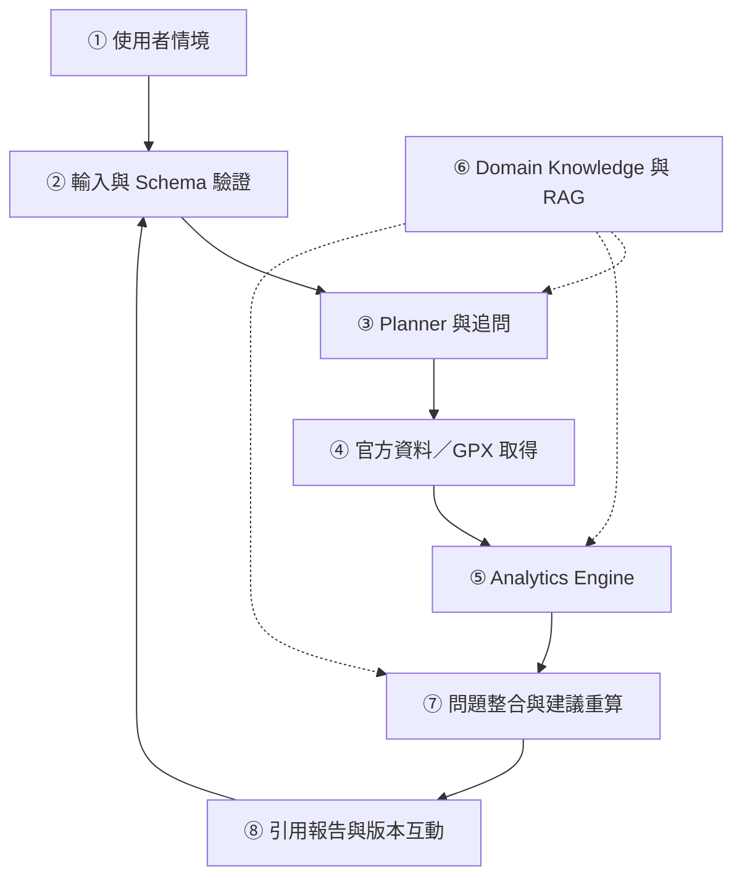
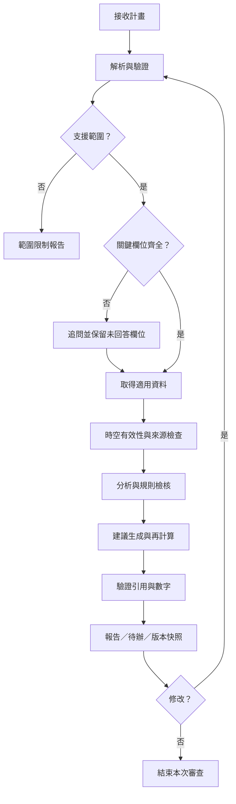

# 系統設計文件
登山計畫審查 AI Agent  
版本 0.1.0｜2026-10-31｜狀態：Proposal 設計，尚未實作

## 1. 問題與目標
將既有登山計畫轉為可追溯、可重新審查的問題清單。每項問題包含觸發條件、計算／規則、來源與時間、影響欄位、建議及未知事項。
第一版聚焦台灣 3 條建檔的非技術路線、單日及兩天一夜。路線待取得合法資料並經核閱後確定。

不包含雪攀、繩索攀登、溯溪與現場救援；不自動申請許可。超出支援範圍須顯示限制。

## 2. Architecture

## 3. 模組契約

| 模組 | 輸入 | 輸出 | 責任與失敗處理 |
|---|---|---|---|
| Parser | 文字／表單、選填 GPX | Plan、欄位原文位置、缺值 | JSON Schema、日期與單位驗證；不可猜缺值 |
| Planner | Plan、支援範圍、工具白名單 | 工作清單、追問、工具呼叫 | 限制呼叫次數、避免無窮迴圈 |
| Acquisition | 日期、路線、工具參數 | Evidence[]、取得狀態 | timeout、最多 2 次重試、記錄失敗 |
| Validity | Evidence、計畫時空範圍 | applicable／stale／uncovered／unknown | 超出預報時效不得拿現在天氣替代 |
| Analytics | Plan、有效證據、參數 | 分段時間、負重、補給餘額 | 可重算數值；標高平滑參數留紀錄 |
| Knowledge | 問題、版本化規則與文件 | 條件式規則、段落與來源 | 文件檢索與規則引擎分開 |
| Reviewer | 數值結果、規則、證據 | Issue[]、候選修改 | 重大問題不可被平均抵銷 |
| Validator | 報告草案、Issue、Evidence | 通過／修正／結構化 fallback | 核對引用、數字及適用範圍 |
| Report | 已驗證結果 | 報告、待辦與審查版本 | 使用者修改後重算全部受影響項目 |

LLM 負責語意解析、任務規劃與文字說明；程式負責數值計算與明確限制判斷。不要求模型輸出私有思考過程，保留工具紀錄與可驗證理由即可。

## 4. Flowchart

## 5. 資料模型
- Plan：id、version、route_id、departure_date、timezone、members、segments、equipment、food、water、camp、turnaround_conditions、contact_plan。
- Segment：起訖、距離 km、爬升／下降 m、地形、時間及休息。
- Evidence：id、source_url、publisher、published_at、retrieved_at、valid_from、valid_to、route_id／geometry、snapshot_hash。
- Rule：id、version、source_ids、scope、condition、priority、review_status。
- Issue：id、rule_id、plan_field、priority、status、condition、evidence_ids、recommendation、unknowns。
- Review：id、plan_version、model_version、rule_version、snapshot_ids、issues、tool_log、created_at。

欄位的 null 表示未知，不等同 false、0 或不適用。每人／團體共用裝備分開紀錄。所有日期保存時區；展示預設 Asia/Taipei。

## 6. 分析規則
分段原型估算：T = d/v + ascent/r + rest。
d、v 為 km、km/h；ascent、r 為 m、m/h；rest 為小時。這是待校準的啟發式，非適用所有路線的安全公式。
參數記錄來源與版本，呈現多情境範圍，未校準前不得宣稱統計信賴區間。
飲水／食物依情境需求與可靠補給逐段計算，需求率必須事先核閱，不由 LLM 即時編造。

| 規則 | 條件 | 行為 |
|---|---|---|
| R01 | 關鍵資訊缺少 | 追問，輸出可完成的部分 |
| R02 | 有效官方封閉與計畫重疊 | 高優先級問題，不以社群紀錄解除 |
| R03 | 氣象過期、涵蓋不符或失敗 | 該項不可判定，列重查待辦 |
| R04 | 條件必要裝備功能缺少 | 顯示觸發條件，區分未填與未帶 |
| R05 | 預估時間超過隊伍截止條件 | 顯示差額、計算假設及候選修正 |
| R06 | 配置依賴未證實水源 | 要求確認／調整，不保證可用 |
| R07 | 修改路線、時間或裝備 | 重算關聯項目，檢查風險轉移 |

狀態為「已發現問題」「需補資料」「本次未檢出問題」「不適用」；不能將未檢出轉成安全保證。

## 7. 預計 API
以下為設計契約，尚未提供可呼叫端點。
- POST /api/plans：驗證並建立計畫版本。
- POST /api/plans/{id}/reviews：建立審查工作，回傳 review_id 與 status。
- GET /api/reviews/{id}：取得 issues、unknowns、evidence 與計算參數。
- PATCH /api/plans/{id}：建立新版本，不覆蓋舊審查證據。
- GET /api/reviews/{id}/evidence/{evidence_id}：回傳可公開引用的來源及時間。

錯誤代碼：INVALID_INPUT、UNSUPPORTED_SCOPE、SOURCE_UNAVAILABLE、SOURCE_STALE、MODEL_FAILURE。部分資料失敗時允許 PARTIAL 報告，不能偽裝完整成功。

## 8. 工具與可靠性
工具採白名單。外部文件只作資料，不執行文件內指令。工具參數經 schema 驗證，不傳不必要個資。
資料取得最多重試 2 次，報告修正最多 1 次；仍失敗則用結構化結果顯示錯誤。
快取依資料產品及有效期管理，重新審查須檢查快取是否仍有效。模型版本、提示版本與來源 hash 保留，支援重現。

## 9. 資料來源
官方入口：https://hike.taiwan.gov.tw/information_2.aspx  
氣象 API：https://opendata.cwa.gov.tw/dist/opendata-swagger.html  
領域規則來源與論文：詳見 [Proposal References](docs/proposal.md#9-references-參考資料)。

實作前確認 API 產品 ID、山域涵蓋、授權與限額。管理公告第一版可人工整理。第三方 GPX 需要授權；公開儲存庫僅收合成或可再散布的範例。

## 10. 評估與驗收
預計 60 個案例，依家族切分開發 24／鎖定測試 36。兩位有經驗者獨立標註並解決分歧；案例、核閱者尚待建立／招募。
比較靜態清單、純 LLM、RAG、完整系統及消融版本。
量測 issue precision／recall／F1、重大漏報率、引用支持率、缺資料處理率、數值一致率、修正可行率、時間與成本。
工程目標：重大問題 recall ≥ 0.90、引用支持率 ≥ 0.95；均為目標而非實驗結果。

最低驗收情境：
1. 未填裝備時追問，而非斷言未攜帶。
2. 官方封閉與日期重疊時指出衝突。
3. 來源失敗或日期超出預報時標示不可判定。
4. 修改飲水量後重新計算負重相關項目。
5. 來源網址、有效時間與報告主張能逐項追溯。
6. LLM 失敗時仍保留已完成分析與錯誤紀錄。

## 11. Repository 維護規則
- 任何 API／欄位／規則／評估方法改動，在同一提交更新本文件。
- 新規則附來源、適用範圍與正反例。
- 測試集鎖定後變更需記錄原因，不用測試結果回頭調參。
- 尚未實作與已驗證功能分開描述。
- 不提交 .env、金鑰、真實隊員個資、聯絡資料或未授權軌跡。

## 12. Design Decisions
| ID | 決策 | 原因 | 狀態 |
|---|---|---|---|
| ADR-001 | 單協調 Agent＋工具 | 控制原型複雜度，便於稽核 | Proposal |
| ADR-002 | 數值與規則由程式執行 | 可重算與可測試 | Proposal |
| ADR-003 | 來源缺漏明確保留 | 避免將未知變為肯定結論 | Proposal |
| ADR-004 | 路線與活動範圍先收斂 | 讓案例標註及驗證可完成 | Proposal |
| ADR-005 | 公開 Repo 僅含可公開素材 | 方便課程檢視並避免洩漏個資 | 已採用 |

## 13. Open Questions
- 具體 3 條路線與授權 GPX？
- 可用山域氣象產品與歷史快照？
- 專家核閱及使用者測試名單？
- 模型預算、需求率及步程參數？
- 團隊分工與課程實際截止日期？

## 14. Changelog
| 版本 | 日期 | 內容 |
|---|---|---|
| 0.1.0 | 2026-10-31 | 建立 Proposal 架構、資料契約、規則、評估與維護機制 |
