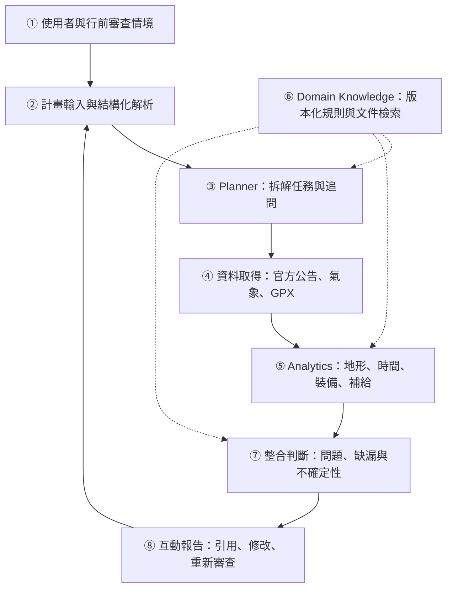
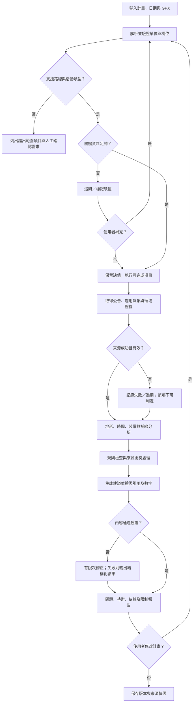

# 登山計畫審查 AI Agent：結合路線、氣象、裝備與補給的行前檢核系統
# Hiking Plan Review Agent: Evidence-Based Pre-Trip Checks Integrating Routes, Weather, Equipment, and Supplies

期末專題提案草稿｜版本 1.0｜資料查核日期：2026-10-31  
適用範圍：台灣登山行前決策支援；以一般健行、單日與兩天一夜非技術路線為原型範圍。  
本文件為提案，系統、資料集與實驗皆屬預計工作，未宣稱已實作或取得成效。

## 1. Abstract 摘要

### A. Attention Getter — Motivation
登山計畫的完整性涉及路線、天候、隊員、裝備與補給之間的配合。消防署於 2025 年 12 月 28 日提醒，低溫、強風與積雪會提高登山風險，並強調完整裝備及計畫通報的重要性 [6]。國家公園署於 2026 年 6 月 13 日發布的提醒亦強調氣象追蹤、撤退規劃與留守制度 [7]。這些近期案例顯示，行前準備需要跨項目檢查，而非僅蒐集單一資訊。

### B. But — Challenge
登山者可從不同平台取得資訊，但仍需自行判斷資料是否適用於預定日期、山域與隊伍。一般清單難以檢查跨項目矛盾；未接入資料的語言模型也無法證明當前路況。本專題將「將分散資訊轉成可追溯的計畫問題清單」界定為研究問題，不主張所有既有產品都缺少此能力。

### C. Cure — Proposed Solution
本專題提出登山計畫審查 AI Agent，讓使用者輸入既有計畫，系統辨識缺漏與衝突，輸出問題、依據、修正建議與待確認事項。

### D. Development — Method
系統以 LLM 解析計畫、規劃工具呼叫及產生說明，以 GPX 分析與程式運算處理距離、爬升、時間及補給，以檢索增強生成（RAG）取得領域文件，並透過版本化規則整合路線公告、氣象及裝備需求。每個結論保留資料時間與引用。

### E. Experiments — Evaluation
預計建立 60 個有來源快照的計畫案例，涵蓋正常、資訊不足與跨項目衝突情境；比較人工靜態清單、純 LLM、LLM＋RAG 與完整系統。以問題辨識 precision、recall、重大問題漏報率、引用支持率、資料不足處理及操作時間評估。

### F. Findings — Expected Outcomes
預期完成可操作網頁原型、領域規則庫與案例資料集，並驗證工具分析與領域規則是否有助於提高審查品質。尚未完成實驗，因此不預先宣稱改善幅度或降低山難的效果。

關鍵字：AI Agent、登山計畫審查、RAG、地理資料分析、決策支援。

## 2. Introduction 緒論

### A. Attention Getter：為什麼值得做
近期官方安全提醒持續要求登山者做好天候評估、裝備準備與撤退規劃 [6][7]。然而，準備項目之間可能存在相互依賴：即使裝備清單完整，行程仍可能缺乏時間餘裕；即使有標示水源，也可能沒有近期可靠紀錄。這些是本專題設計的情境，不是已量測的普遍發生率。

### B. Background：應用與技術背景
目標使用者為有基本登山知識、需要檢查計畫的新手至中階登山者，以及協助審查的社團幹部。輸入包括日期、隊伍資料、分段行程、裝備、食物與飲水配置，並可附 GPX。輸出是可逐項修改、重新審查的報告。
RAG 提供外部知識檢索基礎 [1]；ReAct 展示語言模型與工具交互運作的方式 [2]。本專題採用這些技術作為資料取得與解釋機制，運算仍由可重現的程式負責。

### C. Problem：問題定義
給定登山計畫 P、在審查時間 t 可取得的證據 E，以及領域規則 K，產生問題集合 I。每個問題須包含位置或時間、觸發條件、證據、嚴重程度、建議及資料限制。系統需要回答：
1. 計畫缺少哪些必要資訊？
2. 哪些內容彼此矛盾或不符合明確限制？
3. 哪些問題需要使用者或有經驗者進一步確認？

### D. Existing Limitations：既有方式的限制
靜態清單適合檢查攜帶與否，較難處理日期、路段與負重之間的連動；純 LLM 的當前資訊及運算需額外驗證。2025 年的 τ²-Bench 與 MCP-Bench 亦顯示，多步工具操作及人機協作仍具挑戰 [3][4]。上述研究並非登山系統測試，僅支持本研究必須評估工具與流程可靠性的設計理由。

### E. Innovation：本專題差異
本專題的創新定位為應用整合與可驗證的審查流程：
- 從回答登山問題，轉為檢查使用者既有計畫。
- 以關聯規則檢查天候、裝備、步程與補給的交互影響。
- 明確區分「已發現問題」「需補資料」「本次未檢出問題」。
- 結論附可追溯證據；沒有證據時保留不確定性。
這是預計驗證的設計主張，並非已確認的全球首創。

### F. Contributions：預期貢獻
1. 定義登山計畫結構化欄位、證據格式與版本化規則。
2. 建立整合 LLM、檢索與確定性分析的行前審查原型。
3. 建立含正常與失敗情境、由人員標註的評估資料。
4. 分析不同模組對漏報、引用及使用者理解的影響。

## 3. Related Work 相關研究

### 3.1 AI Technology
RAG 將檢索資料納入生成 [1]，適用於查找裝備與官方說明；ReAct 將推理規劃與外部操作結合 [2]，適合取得缺少的資料。τ²-Bench 關注使用者與 Agent 協作 [3]，本專題可借鏡其受控情境設計。MCP-Bench 評估跨工具任務 [4]，提醒本系統應分別檢查工具參數、分析結果與最終報告。以上方法不自動提供登山風險判準。

### 3.2 Domain Know-how
登山步程研究已將地形、人員因素與疲勞納入模型 [5]，但其對台灣路線的可移植性仍須驗證。消防署近期案例提供天候與裝備的情境依據 [6]；國家公園署說明計畫、通訊與撤退準備的重要性 [7]；玉山國家公園裝備資料強調裝備適用性及正確使用 [8]。政府指引可支援規則制定，但並非模型成效實驗。

### 3.3 Article Summary Table
下表前四列為 AI 技術，後四列為領域研究／官方指引。官方資料明確標示類型；不可將其 Findings 當作實驗成果。對 [5] 目前僅查核摘要與書目，不引用未取得的數值或樣本細節。

| Ref. | Year | Problem | AI Method | Domain Knowledge | Dataset | Findings | Limitation |
|---|---|---|---|---|---|---|---|
| [1] | 2020 | 生成模型外部知識與來源問題 | RAG | 知識密集型 NLP | 論文之問答等 NLP 基準 | 檢索與生成整合可支援知識任務 | 未驗證登山、資料新鮮度仍需另管 |
| [2] | 2022 預印本 | 規劃與外部操作整合 | ReAct | 問答與互動任務 | HotpotQA、FEVER、ALFWorld、WebShop | 展示推理與行動交錯的效益 | 不構成高風險領域保證 |
| [3] | 2025 | 使用者與 Agent 共同操作的評估 | τ²-Bench | 電信支援情境 | 雙控制電信任務 | 協作情境帶來額外挑戰 | 非登山領域 |
| [4] | 2025 | 跨工具多步任務評估 | MCP 工具 Agent benchmark | 多領域工具流程 | 28 個 MCP servers、250 個工具 | 既有模型仍面臨規劃與工具使用挑戰 | 不驗證登山判準 |
| [5] | 2025 | 複雜地形的步程估計 | 混合預測模型，非 LLM | 地形、疲勞與能量 | 公開登山 GPS；摘要未列名稱／規模 | 摘要報告相較傳統公式改善 | 尚需全文核讀及台灣外部驗證 |
| [6] | 2025，2026 更新 | 低溫降雪登山風險 | 無；官方案例提醒 | 裝備、天候與通報 | 官方事件敘述，非實驗資料集 | 列出行前準備重點 | 無模型對照實驗 |
| [7] | 2026 | 不穩定天候下的登山準備 | 無；官方指引 | 行程調整與撤退準備 | 官方公告，非實驗資料集 | 強調整體準備與動態調整 | 不提供可直接套用的風險模型 |
| [8] | 未標明，查閱 2026 | 裝備準備 | 無；領域知識 | 衣著、裝備與使用能力 | 官方裝備說明 | 提供裝備準備原則 | 需依行程轉為條件式規則 |

### 3.4 Existing Research → Limitations → Research Gap → Our Project
既有研究提供檢索、工具協作與步程分析能力，官方指引提供領域原則；但本次查核文獻未直接驗證「台灣登山計畫的跨資料一致性審查」。因此本專題選擇此應用缺口，建立有證據與例外處理的原型，再以案例比較驗證。正式報告仍需持續補充登山規劃與安全決策支援文獻，不能由有限檢索推論不存在相關系統。

## 4. Deep Research

### 4.1 Q1：五個核心思維模式
以下為依官方指引與步程研究整理的工作框架，尚非經專家調查證實的「全體專家共識」；預計由至少兩位有帶隊／審查經驗者核閱。

| 核心思維 | 意義 | 證據與依據 | 如何影響系統設計 |
|---|---|---|---|
| 人、地、天、裝備須共同評估 | 單項條件合理不代表整體計畫合理 | [5][6][7] 涉及人員、地形與環境因素；跨項目框架為本研究整理 | 建立跨欄位規則，不只比對清單 |
| 計畫須有調整與撤退空間 | 出發計畫是可更新的決策，不是登頂承諾 | [7] 的行程調整原則 | 要求撤退條件、備案與重新審查 |
| 冗餘需對應失效情境 | 備援的價值取決於其是否可在主要方案失效時使用 | [6][7] 的備用、離線與通訊準備 | 檢查導航／照明等備援及電力依賴 |
| 資訊有時間與空間適用範圍 | 舊紀錄與鄰近地點資料不能直接視為當前現場事實 | [7] 強調追蹤最新氣象；時空檢查為本研究推論 | 記錄發布、取得、有效時間與路段涵蓋 |
| 能力與裝備使用同等重要 | 擁有裝備不能直接等同具備操作能力 | [8]；[5] 涉及個體差異 | 區分裝備存在、功能可用與使用經驗 |

### 4.2 Q2：三個重要專業爭論
以下選擇三組與設計直接相關的實務取捨；目前未有證據可將其排名為全領域「爭論最激烈」。提案以證據整理及後續專家訪談補強。

**爭論一：輕量化 ↔ 備援與餘裕**
- 觀點 A：減輕負重可能降低移動負擔；[5] 納入裝備限制與人員因素，但沒有直接證明任一輕量方案較安全。
- 觀點 B：天候變化與延誤需要額外保護及備援；[6][8] 支持必要裝備準備。
- 暫定交集：依失效後果與情境決定裝備；不以最低重量作唯一目標。此為本研究整合判斷，待專家確認。
- 未解問題：不同季節與路線，備援收益與負重成本如何量化？
- 設計決策：裝備先分情境必要、條件必要與選配，必要項缺漏不能被重量優勢抵銷。

**爭論二：通用步程公式 ↔ 個人化預測**
- 觀點 A：簡單公式透明、可重現，適合資料不足的基準。
- 觀點 B：坡度、疲勞及個體差異需要更細緻模型；[5] 提供支持，但目前僅取得摘要。
- 暫定交集：兩者都須說明適用條件與誤差；此為本研究方法選擇，並非已建立的統一共識。
- 未解問題：少量隊員紀錄是否足以校準？如何處理泥濘、攀爬與休息？
- 設計決策：先提供可設定的分段估算及情境範圍；有合法時間戳記錄才評估個人化模型。

**爭論三：官方資訊優先 ↔ 納入近期山友回報**
- 觀點 A：官方公告的管理權責及來源明確；[9] 提供申請與狀態資訊入口。
- 觀點 B：山友紀錄可能較貼近局部路段近況，但日期、位置與真實性未必可靠。這是待訪談驗證的實務主張，尚未找到直接比較成效的證據。
- 可確定的界線：非官方回報不能解除官方封閉；其他可信度問題尚無本研究可宣稱的共識。
- 未解問題：如何辨識轉貼、錯誤定位與過期水源紀錄？
- 設計決策：第一版以官方與使用者提供資料為主，社群僅作待確認線索，不擅自推斷水源保證可用。

### 4.3 Q3：十個深度理解問題
1. 為什麼相同距離的兩條路線，預估時間可能差很多？應檢查哪些資料？
2. 若隊伍加入一位經驗較少者，為什麼不能直接使用平均速度安排全隊？
3. 若有雨衣、卻沒有可保持乾燥的保暖層，清單檢查會漏掉什麼？
4. 若水源紀錄來自一個月前，系統應怎麼表示不確定性並建立備案？
5. 縣市預報與高海拔路段有何尺度差異？缺少適用資料時怎麼處理？
6. 增加備援裝備與減輕負重如何取捨？需要什麼證據才能刪除物品？
7. 官方封閉公告與近期成功登頂貼文矛盾時，應如何判斷？
8. 系統說「資訊不足」與「未檢出問題」差在哪裡？介面如何避免誤解？
9. 為什麼總體準確率很高，仍可能漏掉最重要的問題？該看哪些指標？
10. 若修正計畫只是把風險轉移到另一時段或路段，系統如何再次檢查？

## 5. Proposed Scheme / Proposed Design

### 5.1 使用情境與範圍
使用者已擬好行程，希望在出發前檢查。第一版先支援人工維護的 3 條路線樣板、單日／兩天一夜、無繩索技術需求的行程。路線名稱於資料取得與專家審查後選定。
雪攀、溯溪、技術攀登及未建檔路線標示「超出本版評估範圍」。系統提供準備與計畫審查，無法從資料中證明現場安全，亦不自動辦理申請。

### 5.2 System Architecture
圖中編號對應正文模組。虛線為證據與規則輸入。



① 使用者：登山者／社團幹部提交計畫，審查結果由人確認。  
② 輸入：表單及文字計畫，選填 GPX；LLM 轉成 JSON，欄位附原文位置。數字、日期與單位經 schema 驗證，缺值保留 unknown。  
③ Planner：依缺少資訊決定追問及工具，不要求輸出私有思考過程；留下任務清單、工具紀錄與可驗證理由。  
④ 取得：氣象以官方可用產品為主；管理公告先採人工整理及來源連結，只有確認授權與介面後才自動化。  
⑤ 分析：用程式處理數值；解析分段 GPX、檢查時間餘裕、裝備需求及補給餘額。  
⑥ 知識：規則與檢索文件分開保存，規則附來源、版本、適用條件與核閱狀態。  
⑦ 決策：高優先級問題不得被其他正常項目平均抵銷。來源過期或空間不符時，將該項標為不可判定。  
⑧ 輸出：問題清單、路段時間表、證據及待辦；修改後更新全部受影響分析並保存版本。

### 5.3 資料來源與取得方式

| 資料 | 來源 | 原型取得方式 | 品質檢查／限制 |
|---|---|---|---|
| 日期、隊員、裝備、補給 | 使用者輸入 | 表單與 CSV | 缺值追問；不假定自行申報已驗證 |
| 路線、申請與開放狀態 | 一站式服務網及主管機關 [9] | 人工建立來源快照，再評估自動取得 | 不宣稱所有路線有公開 API |
| 氣象與警特報 | 氣象署 [10][11] | 申請可用資料；記錄產品、預報發布及有效時間 | 實作前確認產品 ID、認證、山域涵蓋與限額 |
| GPX | 自錄／取得授權之軌跡 | 上傳 XML／GPX | 檢查座標、標高、跳點與時間戳；GPX 不證明目前可通行 |
| 裝備與準備原則 | 官方文件 [6][7][8] | 人工核閱、分段建索引 | 只對支援情境轉成規則 |
| 水源、營地與補給 | 官方資料及使用者附證據 | 帶日期與位置的人工資料 | 無近期證據不得視為可靠補給 |
| 評估標籤 | 兩位有相關經驗的審查者 | 獨立標註及分歧協議 | 待招募；記錄資格與標註準則 |

網站可以瀏覽不代表允許大量擷取。無法自動取得時保留人工匯入與來源快照，避免把「有 API」列為未查證的既成事實。未來日期超出預報涵蓋時只完成其他項目，列出重查氣象的待辦；不拿現在天氣當出發日天氣。

### 5.4 輸入與證據模型
Plan：plan_id、version、route_id、departure_date、timezone、members、segments、equipment、food、water、camp、turnaround_conditions、contact_plan。  
Segment：起訖點、距離、上下坡量、地形標籤、起迄時間與休息。  
Evidence：evidence_id、source_url、publisher、published_at、retrieved_at、valid_from/to、geometry/route_id、snapshot_hash。  
Issue：issue_id、rule_id、plan_field、priority、condition、evidence_ids、recommendation、unknowns。

對使用者資料僅收集審查所需欄位；測試資料去識別化，避免儲存真實緊急聯絡資訊。外部文本當資料處理，不允許其中的指令改變工具權限或審查規則。

### 5.5 Analytics Engine 與規則
**路線與步程：** GPX 距離用地理距離逐段加總；爬升先處理標高雜訊並記錄平滑參數。分段時間暫定：
T_i = d_i / v_i + ascent_i / r_i + rest_i。
d、v 使用 km、km/h；ascent、r 使用 m、m/h；rest 使用小時。這是原型啟發式，不是 [5] 的模型，也不是適用所有地形的安全公式。v、r 與下坡／地形修正由核閱者設定，呈現樂觀、一般、保守情境；沒有校準前不稱為統計信賴區間。夜間行程本身不自動判定錯誤，而是檢查照明、經驗、備案與時間餘裕。

**裝備：** 基礎清單＋情境條件；記錄每人或團體共用、數量、功能及操作能力。團體裝備不得不加區分地重複要求每人一份。

**飲水與糧食：** 逐段計算「起始攜帶＋有證據補給－情境需求」；需求率為有來源且經審核的設定參數，不由 LLM 臨時生成。區分飲用、炊煮及預備用量；食物以標示或使用者提供的份量／能量計算，不假裝可由照片精準估算個人生理需求。

| 規則例 | 條件 | 輸出 |
|---|---|---|
| R01 資料不完整 | 日期、路線或隊伍關鍵資訊缺少 | 需補資料，仍可提供部分檢查 |
| R02 封閉衝突 | 官方有效公告與預定路段、日期重疊 | 高優先級：修改／延後，附公告 |
| R03 氣象不適用 | 預報超出有效期、涵蓋不符或取得失敗 | 該項不可判定，不使用鄰近低地資料補成事實 |
| R04 裝備不匹配 | 支援情境的必要功能缺少 | 指出缺少功能及觸發條件 |
| R05 時間不足 | 保守情境超過隊伍設定的截止／撤退時間 | 顯示差額，提出縮短或調整的候選方案 |
| R06 補給依賴未證實 | 必須靠未確認水源才能維持餘量 | 需確認或重新配置；不保證現地有水 |
| R07 修改副作用 | 增加裝備、改路線或出發時間 | 重算負重、時間與補給相關項目 |

氣象門檻依主管機關限制及核閱規則配置；沒有通用依據時只標示條件與不確定性，不自訂一個「所有人適用」的風速／雨量安全線。

### 5.6 決策狀態
每個檢核項目為：已發現問題／需補資料／本次未檢出問題／不適用。報告摘要可同時含多種狀態，不以單一總分遮蔽重大問題；「本次未檢出」僅表示在已檢範圍與證據下未觸發規則，不能解讀為出發許可。

### 5.7 Flowchart



### 5.8 Pseudocode

```text
Algorithm 1: Evidence-Based Hiking Plan Review
Input : Plan P, optional GPX G, review time t, knowledge K
Output: Review report R

01: P0 ← ParseToSchema(P); preserve unknowns and original text spans
02: V  ← ValidateSchemaUnitsAndDates(P0)
03: if outside_supported_scope(P0): return ScopeLimitedReport(P0, V)
04: U  ← IdentifyMissingCriticalFields(P0, V)
05: if U ≠ empty: AskUserOnce(U); merge only supplied answers
06: J  ← PlanRequiredTools(P0, K, allowed_tool_list)
07: E  ← AcquireWithTimeoutRetryAndSourceMetadata(J, max_retry=2)
08: E0 ← CheckTemporalSpatialValidity(E, P0, t)
09: mark failed, stale, and uncovered evidence as unknown
10: A  ← AnalyzeGPXTimeEquipmentAndSupplies(P0, G, E0, K)
11: I  ← ApplyVersionedRules(P0, A, E0, K)
12: I  ← ResolveAuthorityConflictsWithoutSuppressingUnknowns(I)
13: C  ← GenerateCandidateRevisions(I, P0, K)
14: C  ← RecheckAffectedConstraints(C, P0, E0, K)
15: R0 ← GenerateReportFromStructuredFacts(I, C, E0)
16: if citation_or_numeric_validation_fails(R0):
17:     R0 ← RepairAtMostOnceOrUseStructuredFallback(I, C, E0)
18: R  ← AttachScopeUnknownsSourceTimesAndAuditLog(R0)
19: SavePlanVersionAndEvidenceSnapshot(P0, R)
20: if user edits P: start a new review with refreshed evidence
21: return R
```

### 5.9 輸出示例
以下完全為合成測試情境，不代表任何真實路線當前情況。
輸入：四人單日行程，計畫跨越隊伍設定的回程截止時間，未填照明備援；飲水配置依賴無日期水源紀錄。
預期輸出：
- 時間問題：列出哪一段超過截止條件及計算參數。
- 裝備待確認：照明未填寫，先追問，不直接斷言未攜帶。
- 補給問題：無日期水源不能作確定補給，要求確認或改配。
- 修改後重新審查：增加飲水會影響負重，調整路線會影響全部分段。
介面須將來源、計算與假設分開呈現。

## 6. Experiments — Evaluation Plan

### 6.1 研究問題
RQ1：完整系統是否比靜態清單與純 LLM 更能識別跨項目問題？  
RQ2：加入規則與時間／空間有效性檢查，是否減少重大漏報及無依據陳述？  
RQ3：使用者是否更容易理解問題並完成合理修正？

### 6.2 案例與標註
預計 3 條已建檔路線，每條 20 案，共 60 案：正常或無預植問題 12 案；單一問題 18 案；多項衝突 18 案；缺資料、過期來源、API 失敗等 12 案。此為預計建置規模，非既有資料集。
同一計畫的微調版本歸為同一案例家族，以免開發與測試洩漏。以家族為單位分為開發 24 案、鎖定測試 36 案；必要時調整數量並如實說明。資料稀少時以規則原型為主，不為符合 AI 字樣而勉強訓練模型。

兩位有登山審查經驗者在看系統輸出前獨立標註問題類別、嚴重程度、證據及可接受修正，討論分歧並保留原始標籤。若無法招募，改由教師核閱並明確降低外部效度主張。合成案例以授權資料和真實規則建構，不能用其表現代表真實事故降低率。
歷史案例只用當時可取得的預報／公告快照，不能把事後實測當作當時預報；若缺歷史預報，改採前瞻蒐集。

### 6.3 Baselines 與公平比較
B0：相同輸入的人工靜態檢核表，記錄問題發現與時間。  
B1：固定模型與提示的純 LLM；不接外部工具。  
B2：相同 LLM＋相同文件語料的 RAG；不啟用數值工具及規則。  
B3：完整系統（LLM＋RAG＋工具＋規則＋證據驗證）。  
另比較移除新鮮度檢查或移除交叉規則的消融版本。B1 到 B3 的資料存取差異需明列，另提供同一來源快照給模型的控制比較，避免把所有差異歸因於架構。固定模型版本、生成設定與案例；記錄工具失敗及成本，不挑選最佳一次回答。

### 6.4 Metrics

| 指標 | 定義與用途 |
|---|---|
| Issue precision | 經標註者認可的檢出問題／全部檢出問題 |
| Issue recall | 檢出的標註問題／全部標註問題 |
| F1 | precision 與 recall 的調和平均 |
| 重大問題漏報率 | 漏掉的重大標註問題／所有重大標註問題 |
| 引用支持率 | 具有有效、適用且支持該主張證據的可查核主張／全部可查核事實主張 |
| 缺資料處理率 | 資料不足案例中正確要求補充或標為不可判定的比例 |
| 數值一致率 | 報告數字可由工具結果重算的比例 |
| 修正可行率 | 候選修正通過既定限制且經核閱認可的比例 |
| 人機操作 | 審查耗時、完成率、理解題與使用者回饋 |
| 系統成本 | 延遲、API 呼叫數、失敗率與每案成本 |

先定義問題匹配準則，以同一問題的重複描述計一次；允許標註者核准未預植但確實成立的問題。對分母為零的指標標示 N/A。採案例家族層級比較與 bootstrap 不確定性估計，小樣本僅作探索結果。

### 6.5 使用者測試與預期目標
預計邀請 8–12 位登山者比較靜態清單與系統，採交錯順序、不同但相近案例，降低學習效應。所有測試均為桌面計畫審查，不安排依系統建議實地涉險。
預先設定工程目標：鎖定測試中的重大問題 recall 至少 0.90、引用支持率至少 0.95；這些是待驗證目標，不是結果。報告漏報個案及區間，不能因達到門檻而聲稱可用於所有登山情境。

## 7. 實作規劃與可行性

### 7.1 建議技術配置
前端：React／TypeScript 表單、路線與時間表、檢核報告。  
後端：Python FastAPI、GPX/XML 解析、地理距離與表格分析。  
資料：SQLite 儲存計畫與快照索引；規則採 JSON／YAML；文件先用關鍵字檢索，必要時增加向量索引。  
Agent：單一協調器＋受控工具呼叫，無需先建立多代理人系統。LLM 只處理解析、檢索規劃及文字說明。實作時再選模型與套件版本，依預算記錄設定。

### 7.2 八週里程碑

| 週次 | 工作 | 可交付成果 |
|---|---|---|
| 1 | 核定範圍、來源及評估準則 | 路線候選、欄位表、文獻與規則草案 |
| 2 | 資料整理與快照 | 3 條路線樣板、來源表、20 條初始規則 |
| 3 | 表單、GPX 與數值工具 | 可重現計算、缺資料處理 |
| 4 | 檢索與 Agent 串接 | 解析、追問、工具呼叫紀錄 |
| 5 | 報告與修改循環 | 附來源報告、版本比較 |
| 6 | 案例標註與開發評估 | 60 案目標、鎖定測試集 |
| 7 | Baseline、消融與使用者測試 | 比較表、錯誤分析 |
| 8 | 修正與成果整理 | 網頁原型、報告、展示腳本 |

### 7.3 風險與替代方案
API 不可取得：使用有日期的授權／人工快照，清楚顯示非即時。  
GPX／時間戳不足：使用人工核閱路段資料，不宣稱已驗證步程預測。  
模型成本：快取文件與計算結果、限制呼叫，規則仍可獨立執行。  
來源矛盾：保留雙方證據；管理限制依有效官方公告處理，其他矛盾要求確認。  
專家不足：縮小案例與主張範圍，不以 LLM 自評替代全部標註。  
系統故障：保留部分報告與失敗狀態，不以空白資料產生肯定結論。

## 8. Expected Outcomes 預期成果
1. 可輸入、檢查、修改與重新審查的網頁原型。
2. 具來源、適用範圍與版本紀錄的領域規則庫。
3. 具案例家族、來源快照與人工標籤的測試資料。
4. Baseline／消融比較與可重現評估程序。
5. 檢核品質、失敗原因及適用限制的實證報告。
不預先承諾降低事故率；本研究能直接驗證的是計畫問題辨識及審查流程品質。

## 9. References 參考資料
以下來源皆於 2026-10-31 查核。基礎論文保留原年份；未標日期的網頁不以查閱年冒充發布年。論文表格為摘要層級整理，正式提交前應核讀全文與核對格式。

[1] Lewis, P., et al. (2020). Retrieval-Augmented Generation for Knowledge-Intensive NLP Tasks. https://arxiv.org/abs/2005.11401  
[2] Yao, S., et al. (2022, revised 2023). ReAct: Synergizing Reasoning and Acting in Language Models. https://arxiv.org/abs/2210.03629  
[3] Barres, V., et al. (2025). τ²-Bench: Evaluating Conversational Agents in a Dual-Control Environment. https://arxiv.org/abs/2506.07982  
[4] Wang, Z., et al. (2025). MCP-Bench: Benchmarking Tool-Using LLM Agents with Complex Real-World Tasks via MCP Servers. https://arxiv.org/abs/2508.20453  
[5] Dalland, K., Wang, C., Dantu, K., Chowdhury, S., & Esfahani, E. T. (2025). Hybrid Human Model for Time of Hike Prediction. EMBC, 1–6. DOI: 10.1109/EMBC58623.2025.11253206. https://pubmed.ncbi.nlm.nih.gov/41335675/  
[6] 內政部消防署（2025-12-28；2026-01-06 更新）。低溫降雪風險升高，消防署提醒登山務必備齊關鍵裝備。https://www.nfa.gov.tw/cht/index.php?article_id=20218&code=list&flag=detail&ids=1468  
[7] 內政部國家公園署（2026-06-13 更新）。國家公園署呼籲：登山活動務必攜帶充足裝備，「山永遠都在」，必要時請果斷暫緩行程。https://www.taiwan.nps.gov.tw/home/zh-tw/news/33530  
[8] 玉山國家公園管理處（未標日期）。登山裝備。https://www.ysnp.gov.tw/StaticPage/Equipment  
[9] 臺灣登山申請一站式服務網（動態網站）。天氣資訊及路線、申請服務入口。https://hike.taiwan.gov.tw/information_2.aspx  
[10] 中央氣象署（動態文件）。Opendata API 線上說明文件。https://opendata.cwa.gov.tw/dist/opendata-swagger.html  
[11] 中央氣象署（動態文件）。開放資料開發指南。https://opendata.cwa.gov.tw/devManual/description

## 附錄：作業規範對照
- Abstract A–F：第 1 節。
- Introduction A–F：第 2 節。
- Related Work 約半 AI／半領域、Article Summary Table、研究缺口：第 3 節。
- Deep Research 五個模式、三個爭論、十個問題：第 4 節；共識及爭論排名仍待專家驗證。
- 編號架構圖與逐一說明：第 5.2 節。
- Flowchart：第 5.7 節。
- 有行號 Pseudocode：第 5.8 節。
- Dataset、Baseline、Metrics 與使用者測試：第 6 節。
- 未虛構 Findings：第 1F、6.5、8 節明列為預期。

